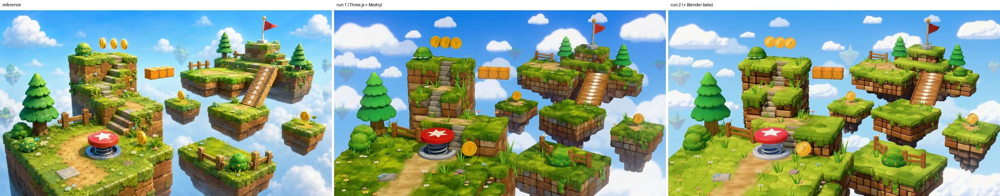
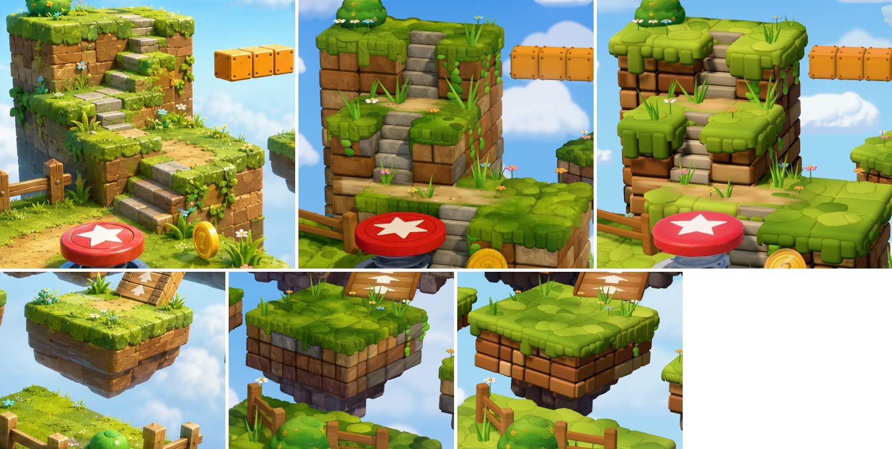
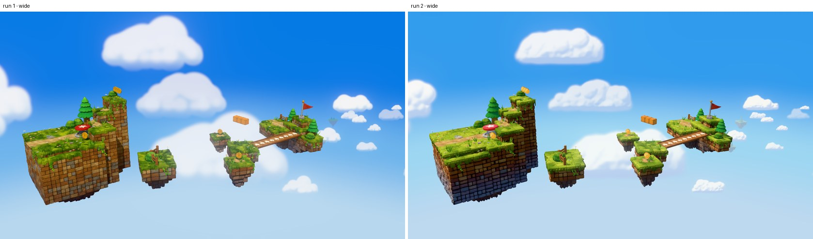
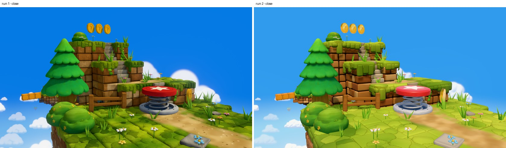
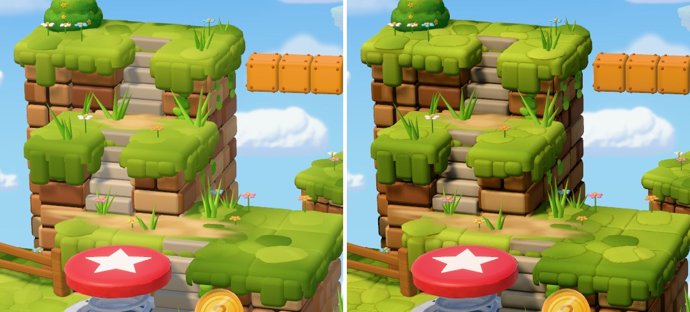

# Blockfield smoke test — run 2 report (materials and lighting)

Run 2 keeps run 1's layout, camera and prop placement and only changes materials, lighting and the island meshes.
Run on 2026-11-23, 22:26 → 23:17 UTC for the final render (iteration cap of 6 reached; 90-minute cap not reached).
Run 1's report is [`REPORT.md`](REPORT.md).

## Result

Reference, run 1, run 2 — same camera:



Detail crops (reference, run 1, run 2):



Other two fixed cameras, run 1 against run 2:




Run 2 progression, iterations 1–6: [`shots/run2-final/progression.jpg`](shots/run2-final/progression.jpg).
Full-size stills: `shots/run2-final/{reference,run1,run2}.jpg`; per-iteration shots in `shots/iter-r2-N/`.

## Rating against the reference: 7 / 10 (run 1 was 6)

For the material and lighting gap alone I would put run 1 at about 4.5 and run 2 at about 6.5.

| Item from the brief | Score | Why |
|---|---:|---|
| 1. Block shape | 7 | Every brick, step and rock is bevelled and rounded; moss caps are 0.5 units thick, hang 0.15–0.2 over each edge and end in hanging lobes. Still too regular: bricks are one of two sizes on a grid, and the lobes read as icing drips rather than ragged leafy moss. |
| 2. Texture detail | 6 | The tiled detail textures and bump maps are gone; colour is large smooth shifts. It overshoots: surfaces are now cleaner than the reference and read as clay or plastic rather than hand-painted. Measured fine-detail energy in the terrain area (mean absolute Laplacian): reference 12.4, run 1 9.7, run 2 8.3. |
| 3. Baked lighting | 7 | Cycles-baked soft shadow in the mortar gaps, between caps and mounds, and under the overhangs. The under-overhang band is weaker than the reference's, and the sun's direct shadows are still a real-time shadow map (see "hybrid" below). |
| 4. Light and atmosphere | 7 | Warm sun from the reference's upper-left, Neutral tone mapping, gentle bloom, distance fog, four hazy background islands. Whole-image colour is close: mean RGB 139/163/129 against 136/162/141, saturation 145 against 131 (run 1: 120/144/123 and 150). |
| 5. Materials | 6 | Star: a clean five-pointed star (9/10). Coins: gold with a readable "?" on both sides and a metallic rim, but the gloss on the face is mostly painted, not reflected (6/10). Stone sheen: present but barely visible (5/10). |
| 6. Clouds | 6 | Shaded, feathered and puffier than run 1's flat shapes. Still sprites, and more "cotton" than the reference's painterly cumulus. |

Biggest remaining gap: the reference's surfaces have painted micro-variation (leafy moss, chipped irregular stones). Run 2 traded
run 1's busy tiling for surfaces that are too smooth.

## What Blender contributed versus Three.js alone

**Blender did three things** (`blender/build_islands.py`, driven headless with `blender -b -P`):

1. **Island meshes.** One merged mesh per island: bevelled bricks with mortar gaps over a dark core, stair slabs, underside rocks,
   moss caps, hanging lobes and low moss mounds. 187k triangles for the six islands, plus one 3.6k low-poly island instanced four
   times in the background. Albedo is stored as vertex colours.
2. **UV unwrap and packing** (smart project, then repack with buried faces shrunk) — 0.1–0.5 s per island.
3. **Lighting bake** (Cycles, CPU, 64 samples, 1024² maps): sky visibility, two diffuse bounces and a soft 14° share of the sun.
   Exported in the GLB as the base-colour texture; Three.js rewires it to `lightMap` + `aoMap`.

**How much of the look is the bake?** Same meshes with the bake switched off (`?lm=0`, hemisphere light only) against on:



(full frame: [`shots/run2-final/bake-off-vs-on.jpg`](shots/run2-final/bake-off-vs-on.jpg))

The bake adds the dark mortar lines, the creases between moss caps and the shading under overhangs. It is a real but moderate
difference. Most of the jump from run 1 comes from the rounded geometry and the new palette, and those did not strictly need
Blender: the script builds every block from an analytic rounded-box template (one `bmesh` bevel, then numpy), which Three.js
could also do. No sculpting or organic modelling was done in Blender.

**What the bake replaced at runtime:** run 1's GTAO pass (a second full scene render every frame) and half the shadow map
(4096² → 2048²). The baked shading is free per frame and view-independent.

**Hybrid, not fully baked:** the sun's direct light and its shadows are still real-time, so props, fences, the ramp and the
spinning coins cast onto the baked terrain without proxy geometry in Blender. Only a soft share of the sun is in the lightmap.

**Three.js alone did:** sun and shadow map, tone mapping, bloom, fog, a one-pass colour grade, the procedural sky, cloud sprites
and PMREM environment map, the coin faces and five-point star, flora, fences, ramp, dirt decals, prop instancing, and prop
simplification (gltf-transform, no Blender).

**Toolset verdict:**
- **Blender as a scripted baker: keep.** A full rebake of everything takes about 4.5 minutes on 4 CPU cores with no GPU, it is
  deterministic, and it removes the most expensive runtime pass.
- **Blender as a modeller: unproven here.** Scripted boxes got the shapes rounded but not hand-made. Closing the remaining gap
  needs real modelling or texture work (procedural displacement or remeshing for ragged moss and chipped stone, or painted
  textures), which this run did not attempt.

## Bake times

Final bake (iteration 6), Cycles CPU, 64 samples, 4 cores:

| Island | Triangles | Lightmaps | Build + UV | Bake |
|---|---:|---|---:|---:|
| A (main + tower) | 94,954 | 2 × 1024² | 1.4 s | 20.7 s |
| D (flag island) | 44,340 | 2 × 1024² | 0.7 s | 38.2 s |
| F (under ramp) | 14,364 | 2 × 1024² | 0.2 s | 49.1 s |
| E (coin island) | 8,604 | 2 × 1024² | 0.2 s | 55.6 s |
| G (right coin island) | 8,010 | 2 × 1024² | 0.1 s | 50.7 s |
| H (front island) | 16,770 | 2 × 1024² | 0.3 s | 47.8 s |
| BG (background, instanced ×4) | 3,644 | 1 × 512² | 0.1 s | 3.5 s |
| **Total** | | 12 × 1024² + 1 × 512² | | **266 s** (274 s with build and export) |

- Six full bake runs, one per iteration: 414 s, 285 s, 290 s, 286 s, 278 s, 274 s — about 30 minutes of background CPU time in
  total. The first was slower because the helper's screenshot renders shared the CPU.
- First test bake (island E, one 512² map, 32 samples): 2.6 s.
- Bake time does not track triangle count (the largest island is the fastest). I did not investigate why.
- The Cycles denoiser flag is set, but I did not verify that it applies to bakes. The maps look clean at 64 samples.

## Triangles and performance

**268,126 triangles** in the whole scene (run 1: about 731,000; budget 300,000). 102 draw calls.

| Part | Triangles |
|---|---:|
| Six Blender islands | 187,042 |
| Background islands (4 instances) and their trees | 14,912 |
| Meshy props, instanced (3 pines, 5 bushes, 6 coins, spring, flag) | 30,547 |
| Fences, ramp, orange blocks, flora, flowers, vines | 33,489 |
| Sky dome, decals, misc | ~2,100 |

Meshy props, simplified with `gltf-transform simplify`:

| Prop | Before | After | Kept |
|---|---:|---:|---:|
| Pine | 4,165 | 3,633 | 87% |
| Bush | 2,428 | 1,820 | 75% |
| Coin | 1,433 | 875 (939 with painted faces) | 61% |
| Spring pad | 4,134 | 3,098 (3,614 with cap and star) | 75% |
| Flag | 2,600 | 1,300 | 50% |

The props were only about 40k of run 1's 731k, so the budget was met by replacing the terrain. Props were simplified less than
planned: at 50% the pine showed dark slits and the bush had holes.

Runtime passes: main render, one 2048² shadow map, bloom, output, colour grade. No screen-space AO.
**Frame rate is still unmeasured**: there is no GPU here. In software GL a single still takes 6–8 s (run 1: about 14 s).

Download size went up: the island GLBs are 14.4 MB in total (island A is 6.5 MB), uncompressed.

## Meshy credits

**0 used.** Balance 3,864 before and after. The star was fixed procedurally, so no new model was needed.

## Delegations

| # | To | What | Why | Duration |
|---|---|---|---|---|
| 1 | Forked sub-agent in its own git worktree | Three.js-only work: soft cloud sprites, PMREM environment map, metallic coin material, procedural five-point star on the spring pad, prop simplification. | Independent of the Blender pipeline and split by file, so it ran in parallel with writing the bake script. | 11 min 47 s (22:30:47 → 22:42:34), 45 tool calls |

Kept from the helper: clouds, environment map, star, simplified props. Replaced later in the main session: its coin treatment
(the Meshy texture left scribbled seams on the mirror-like face), swapped for painted gold faces in iteration 6.

## Time

Start 22:26 UTC. Each iteration is: change, rebake all islands (about 4.6 min in the background), render, compare.

| Iteration | Rendered (UTC) | What changed |
|---|---|---|
| Setup | 22:34 | Read run 1, exported the island grids to `blender/layout.json`, wrote the Blender script, first test bake. |
| 1 | 22:43 | Blender islands with baked lightmaps replace run 1's instanced boxes; tiled textures, bump maps and GTAO removed; fog added. Soft but washed out. |
| 2 | 22:52 | Sun moved to the reference's upper-left; mortar gaps over a dark core; moss lumps; darker palette; environment map; sky colours; Neutral tone mapping and grade pass; 3D background islands; helper's files merged. |
| 3 | 22:59 | Softer cap seams, rounder lumps, haze by depth instead of per island, "?" on both coin faces, flora triangle cuts. |
| 4 | 23:05 | Higher sun and lower ambient so walls are darker than tops; darker bricks and steps; finer moss colour variation. |
| 5 | 23:11 | Moss lumps became squashed soft mounds; shorter lobes; domed coin faces (did not help: coins still read flat orange). |
| 6 | 23:17 | Desaturated moss, sky and grade to match measured reference colours; painted gold coin faces. |
| Report, A/B render, cleanup, PR | 23:21 | |

Total: **51 minutes to the final render, about 55 minutes including the report and PR.**

## What didn't work or is still wrong

- **Too smooth.** See item 2 above. A painted detail layer at low contrast would likely help more than further geometry.
- **Regularity.** Bricks, caps and lobes sit on the grid with two brick sizes. The reference's stones vary in size and tilt.
- **Moss mounds read as lily pads** from the close camera; iteration 2's version looked like paving stones.
- **Coins**: a metallic material alone looked like flat orange plastic, because a flat face reflects one sky direction. The
  final gloss is a painted glint plus a metallic rim.
- **Stone sheen is subtle** (roughness 0.48 with a weak environment reflection); it shows on bevels in the close camera only.
- **Sun shadows are not baked** (see "hybrid" above).
- **Lightmap resolution on island A is low** for its size (two 1024² maps); fine for soft light, too coarse for crisp shadows.
- **Layout changes need a re-export and rebake** (`scripts/export-layout.cjs`, then the Blender script).
- **Carried over from run 1, untouched:** vines are strings of leaf blobs, a few flowers grow through the stone slab, the
  dirt path is a flat decal just above the moss. The `?block=meshy` A/B mode from run 1 was not re-tested.

## How to run

```bash
cd smoke-test
npm install
npm run dev                         # http://localhost:5173/
```

Rebuild and rebake the islands (dev server must be running for the layout export):

```bash
node scripts/export-layout.cjs
```

```bash
blender -b -P blender/build_islands.py -- blender/layout.json public/models/islands
```

Screenshots and comparison:

```bash
node scripts/shots.cjs r2-7 && python3 scripts/compare2.py r2-7
```

URL flags: `?cam=ref|wide|close`, `?lm=0` (islands without the baked lightmaps), `?post=0`, `?still=1`, `?sat=` and `?con=` (grade).

## Human interventions

**0.**
