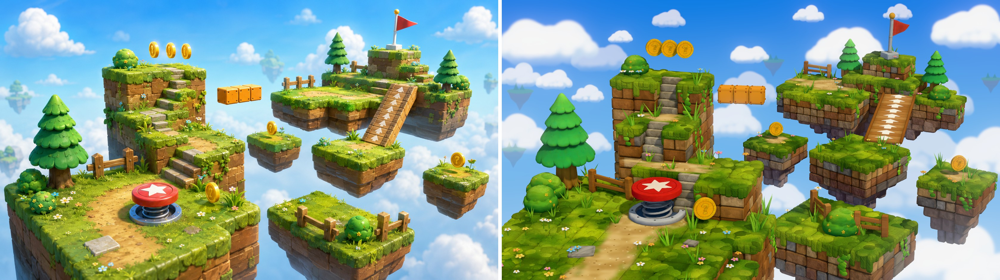
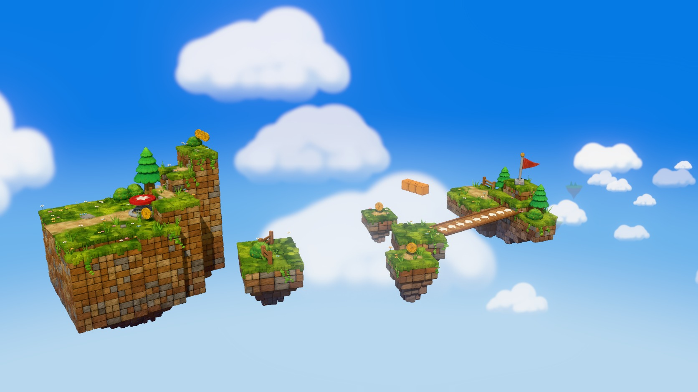
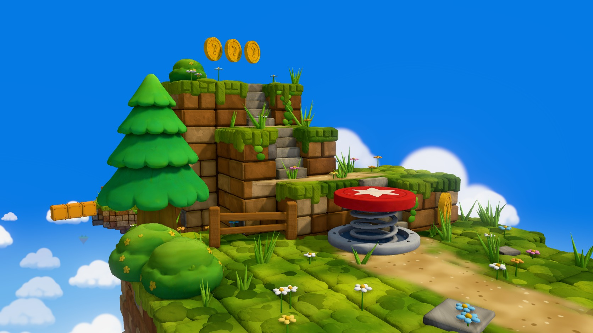
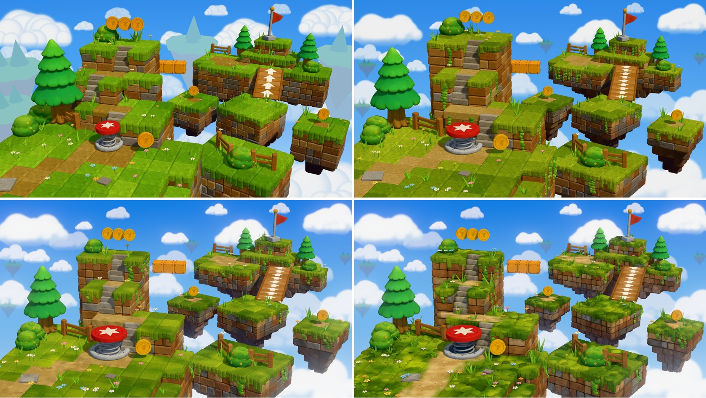

# Blockfield smoke test — report

Rebuild of `reference/blockfield_direction.png` as a real-time Three.js scene (Vite + Three.js r170, Meshy props).
Run on 2026-11-23, 20:59 → ~21:55 UTC. Iteration cap (8) reached; time cap (2 h) not reached.

## Result

Reference (left) vs final render, iteration 8 (right), same framing:



Other two fixed cameras (final):

| Wide | Close |
|---|---|
|  |  |

Progression (iterations 1, 3, 5, 8):



All per-iteration screenshots: `shots/iter-N/{ref,wide,close}` plus `compare.jpg` (reference over render) and
`overlay.jpg` (50/50 blend). Iterations 1–7 are stored as JPEG to keep the repo small; iteration 8 is PNG.

**Honest rating: 6 / 10.**

| Aspect | Score | Why |
|---|---:|---|
| Composition / layout | 8 | Every element is present and lands within a few dozen pixels of its reference position in the matching camera. |
| Props (Meshy) | 7 | Pine, bush, flag are close. Coin is flat non-metallic orange with "?" on one side only. Spring pad star has 6 points, not 5. |
| Terrain surfaces | 4–5 | Reads as tidy grid-aligned blocks. The reference has irregular hand-sculpted stones, ragged moss overhangs and leafy plants. |
| Sky / light / atmosphere | 5 | Gradient, sprite clouds, soft shadows, AO and light bloom are in, but it lacks the reference's painterly glow and volumetric clouds. |

## How to run

```bash
cd smoke-test
npm install
npm run dev            # http://localhost:5173/
node scripts/shots.cjs 9 && python3 scripts/compare.py 9   # headless screenshots (dev server must be running)
```

URL flags: `?cam=ref|wide|close` (keys 1/2/3 also switch), `?ao=0` (no GTAO), `?post=0` (no post-processing),
`?still=1` (render one frame; used for headless shots), `?block=meshy` (A/B: islands built from the Meshy-retextured block).

## Time

Start 20:59:31 UTC. Times are when each iteration's screenshots finished.

| Iteration | Finished (UTC) | Duration | What changed |
|---|---|---:|---|
| 1 | 21:15:04 | 15.5 min | Scaffold, all procedural builders, sky, prop loader, screenshot script. First end-to-end render with Meshy GLBs. |
| 2 | 21:19:48 | 4.7 min | Longer lens (30° → 16° FOV) and lower pitch to match the reference's near-orthographic look; softer clouds; palette; halved triangle count. |
| 3 | 21:24:31 | 4.7 min | Tower footprint re-derived from reference pixels; island D made L-shaped so the ramp sits in its notch; tapered undersides; vines; hazy distant islands. |
| 4 | 21:28:13 | 3.7 min | Main island scaled 0.9; cool fill light; Meshy-block A/B rendered; checked wide/close cameras. |
| 5 | 21:32:46 | 4.5 min | Sky gradient; world-space texture mapping; clouds all around; bloom; position tweaks. |
| 6 | 21:36:41 | 3.9 min | Painted edge-darkening per block; warmer bricks and stairs. |
| 7 | 21:43:40 | 7.0 min | Moss lumps, soft-edged dirt path decals, GTAO, steel ring under the spring. Includes one failed screenshot run (see below). |
| 8 | 21:44:59 | 1.3 min | Path re-routed, smaller grass tufts, lighter undersides and bricks. |
| Report, cleanup, commit, PR | ~21:55 | ~10 min | |

Total: **45.5 min to the final render, about 55 min including the report and PR.**

## Meshy credits

Cap 500. **Used 136** (balance 4000 → 3864, re-checked at the end). Full call log: [`meshy-log.md`](meshy-log.md).

| Asset | Credits | Calls | Final GLB |
|---|---:|---|---|
| Pine tree | 18 | 1 image cleanup + 1 image-to-3D | `public/models/pine.glb`, 4,165 tris, 406 KB |
| Bush | 36 | 2 cleanups + 2 image-to-3D (v1 rejected) | `public/models/bush.glb`, 2,428 tris, 345 KB |
| Coin | 18 | 1 cleanup + 1 image-to-3D | `public/models/coin.glb`, 1,433 tris, 352 KB |
| Star spring pad | 36 | 2 cleanups + 2 image-to-3D (v1 rejected) | `public/models/spring.glb`, 4,134 tris, 441 KB |
| Goal flag | 18 | 1 cleanup + 1 image-to-3D | `public/models/flag.glb`, 2,600 tris, 357 KB |
| Grass block retexture (one try) | 10 | 1 retexture | `public/models/grass_block.glb` (not used by default) |

Pipeline per prop: crop from the reference → `image_to_image` (nano-banana, 3 credits) to isolate the object on white →
`image_to_3d` smart-topology (meshy-t2.5 geometry + meshy-n1 texture, 15 credits) → GLB, texture resized to 1024² JPEG.
Each prop is loaded once and drawn with `InstancedMesh` (3 pines, 5 bushes, 6 coins, 1 spring, 1 flag).
All five were checked in screenshots.

**Retexture verdict: dropped.** A/B in `shots/iter-4/ref-block-meshy.jpg`. Meshy painted every face of the block as a
stone side with a grass fringe (no grass top), two side panels have ghosted bricks, and the flat orange style repeats
obviously when tiled. The procedural instanced bricks + grass tiles look better, so they are what the scene uses.

## Delegations

| # | To | What | Why | Duration |
|---|---|---|---|---|
| 1 | Forked sub-agent (same context) | The whole Meshy pipeline: crop the 5 props, clean the crops, run image-to-3D, download and shrink the GLBs, run the one retexture experiment, write `meshy-log.md`. | Meshy tasks are mostly waiting on remote jobs and are independent of the procedural scene code, so running them in the background let the scene be written in parallel. | 7 min 16 s (21:02 → 21:09), 72 tool calls |

Everything else (scene code, screenshots, comparison, report) was done in the main session.

## What worked

- **Screen-space placement.** A `place(refPixelX, refPixelY, distance)` helper unprojects reference-image pixels through
  the reference camera, so islands, clouds and props are positioned directly from measurements on the reference image.
  Combined with a per-island yaw this got the framing close by iteration 3.
- **Instanced procedural terrain.** Islands are height grids turned into instanced rounded boxes: grass cap tiles,
  hanging fringe, brick courses, a shrinking stack of rocks for the underside. ~5,700 instances in ~20 draw classes.
- **Cheap stylisation in the shader.** World-space UVs to stop per-tile texture repetition, and a per-block
  edge-darkening term driven by a normalised local-position attribute, gave a hand-painted "cushion" look for free.
- **Moss lumps, alpha-edged dirt decals and GTAO** (iteration 7) were the biggest single jump in closeness.
- **Meshy image-to-3D from cleaned crops** produced usable low-poly props (1.4k–4.2k tris) in about 8 minutes total.
- **Overlay/compare images** each iteration made the gaps measurable instead of eyeballed.

## What didn't work

- **Meshy retexture as a tileable terrain material** (see above).
- **First Meshy attempts for the bush and spring pad** were rejected (hallucinated lump; star turned into a broken arrow).
  The kept spring pad still has a 6-point star and a slightly broken base ring; a procedural steel ring was added under it.
- **Coin**: not metallic, "?" on one face only. Tinted toward yellow in code; there is no environment map to make it shine.
- **The reference is not a consistent perspective image.** Matching it needed a 16° lens and islands spread 30+ units
  apart in depth. From the wide camera this shows: the islands look small and far apart, and the main island's base is a
  large brick mass that the reference never reveals.
- **Headless rendering is slow.** Software GL (SwiftShader) took 50–65 s per screenshot until a single-frame mode
  (`?still=1`) cut it to ~14 s. Adding GTAO to the animation loop made one screenshot run time out (iteration 7) before that fix.
- **Known defects left in at the iteration cap:** a few flowers grow through the stone slab on the path; vines are strings
  of leaf blobs; stairs are narrower and greyer than the reference; the main-island fence is partly hidden behind the pine;
  clouds are flat billboards; block edges are perfectly grid-aligned.
- **Performance is unmeasured on a real GPU.** The scene is ~731k triangles in total (about 40k of that is the Meshy prop instances),
  rendered in a main pass, a 4096² shadow pass and an AO pre-pass. That should be fine on a desktop GPU but I could only run
  it in software GL here, so no FPS number. `?ao=0` and `?post=0` are the first things to turn off on weak hardware.

## What I'd need to get closer

- **Blender (or any DCC tool)** to sculpt irregular stones, ragged grass overhangs and island silhouettes, and to bake
  AO/curvature into textures. This is the main gap; procedural boxes cap out around where this scene is.
- **A seamless-texture generator** (tileable PBR grass/stone/dirt) instead of Meshy's per-object retexture.
- **More Meshy props**: broad-leaf plant, flower clump, a proper 5-point star pad, a two-sided metallic coin. Budget allows
  (364 credits left under the cap).
- **More iterations** for volumetric/3D clouds, an environment map and colour grading, per-island irregularity, wider stairs.
- **A real GPU** to measure and tune frame rate.

## Human interventions

**0.** No questions were asked and no approvals were needed; the Meshy spend was covered by the stated 500-credit cap.
